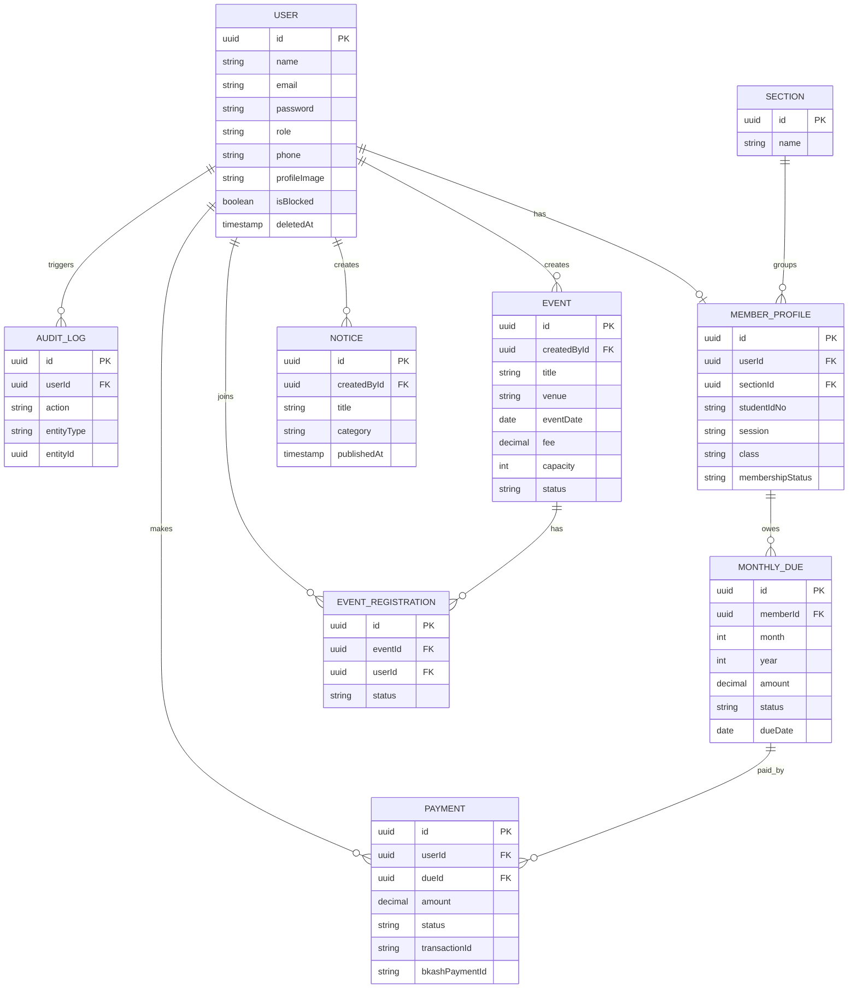

# University Organization Management System (Backend API)

A backend-only REST API for an **unofficial college student organization** (for example the student body of a college). Students register, create a member profile, get approved by a moderator, join events, read notices and pay their **monthly membership fee through bKash**. Moderators, admins and a super admin manage the organization through role-based permissions.

There is no frontend. The API is documented and demonstrated with a Postman collection.

- **Live API:** `https://YOUR-APP.vercel.app` (replace after deployment)
- **Base path:** `/api/v1`
- **Postman collection:** `postman/University-org-management-FULL.postman_collection.json`

---

## Tech stack

| Area | Technology |
|---|---|
| Runtime and framework | Node.js (18+), TypeScript, Express.js |
| Database and ORM | PostgreSQL (Neon) with Prisma 5 (multi-file schema) |
| Validation | Zod |
| Authentication | Email and password, Google login, JWT access and refresh tokens in httpOnly cookies |
| Cache and temporary state | Redis (Upstash) for password reset OTPs |
| Email | Nodemailer (Gmail SMTP) |
| File upload | Multer (memory storage) and Cloudinary |
| Payment | bKash Tokenized Checkout (sandbox) |
| Security | bcrypt, helmet, CORS, express-rate-limit |
| Documentation | Postman |
| Deployment | Vercel |

---

## Features

- **Roles:** Guest, Member, Moderator, Admin, Super Admin, with a role hierarchy and strict permissions
- **Authentication:** register, login, refresh token, logout, Google login, forgot password with a 6 digit email OTP, reset password, change password
- **Profile picture:** upload and replace (the previous picture is deleted from Cloudinary), remove
- **Membership:** member profile with approval flow (`PENDING` to `ACTIVE`), public member directory with search, filter and pagination
- **Contact privacy:** member phone numbers are visible only to Moderator, Admin and Super Admin
- **Events:** create, update, status flow, registration with seat limit protected against double booking
- **Notices:** categories, scheduled publishing, search and filter
- **Monthly dues and payments:** dues generated per month for all active members, paid through bKash with status tracking
- **Audit log:** critical actions are recorded (who changed what)
- **Soft delete:** users, members, events and notices are never hard deleted

### Requirement checklist

| Requirement | Status |
|---|---|
| 3 or more roles with enforced permissions | Member, Moderator, Admin, Super Admin |
| Payment integration (not cash, not fake status) | bKash with create, callback, execute, verify and status tracking |
| 20+ meaningful APIs | 49 endpoints |
| Versioned routes | `/api/v1/...` |
| Consistent response format | Yes (see below) |
| Bearer / token authentication and role middleware | JWT cookies and `auth(...roles)` middleware |
| Zod validation on inputs | Yes |
| Pagination, filtering, sorting, search | Members, events, notices, users, dues, payments |
| Soft delete | Yes (`deletedAt`) |
| Audit logs | Yes (`AuditLog` table) |
| Business logic beyond CRUD | Status transitions, transactions, idempotent due generation, role hierarchy |
| Rate limiting, helmet, CORS | Yes |
| Database indexing, efficient queries, transactions | `select` on queries, unique constraints, row-locking transaction |
| File upload | Multer and Cloudinary |
| Email | Nodemailer |
| Redis | OTP storage with automatic expiry |

---

## Response format

Success:

```json
{
  "success": true,
  "message": "Operation successful",
  "meta": { "page": 1, "limit": 10, "total": 42 },
  "data": {}
}
```

`meta` is present only on paginated lists.

Error:

```json
{
  "success": false,
  "message": "Validation Error",
  "errors": [{ "path": "email", "message": "Please provide a valid email" }]
}
```

---

## Roles and permissions

Role hierarchy: `SUPER_ADMIN > ADMIN > MODERATOR > MEMBER`. A user can only manage users below their own role and can only give roles below their own role.

| Action | Guest | Member | Moderator | Admin | Super Admin |
|---|:-:|:-:|:-:|:-:|:-:|
| Read notices, events, public members | Yes | Yes | Yes | Yes | Yes |
| See member phone numbers | No | No | Yes | Yes | Yes |
| Create own member profile, update own profile | No | Yes | Yes | Yes | Yes |
| Register for an event | No | Yes (ACTIVE member) | Yes (ACTIVE member) | Yes (ACTIVE member) | Yes (ACTIVE member) |
| Pay own monthly due | No | Yes | Yes | Yes | Yes |
| Approve members, assign section | No | No | Yes | Yes | Yes |
| Create, edit and delete notices and events | No | No | Yes | Yes | Yes |
| List all dues | No | No | Yes | Yes | Yes |
| Generate monthly dues, list all payments | No | No | No | Yes | Yes |
| List, block, delete users | No | No | No | Yes | Yes |
| Promote a member to Moderator | No | No | No | Yes | Yes |
| Promote a member to Admin | No | No | No | No | Yes |

Notices and events use plain role checks only. There is no committee or panel ownership logic.

### Promotion flow

```
Register -> Login -> Create member profile (PENDING)
   -> Moderator approves (ACTIVE)   => the user is now a member
   -> Super Admin: PATCH /users/:id/role { "role": "ADMIN" }
   -> Admin:       PATCH /users/:id/role { "role": "MODERATOR" }
```

### Seeded accounts

When the server starts, `src/seed.ts` creates one Super Admin, one Admin and one Moderator if that role does not exist yet. Names, emails and passwords come from the `.env` file (`SUPER_ADMIN_*`, `ADMIN_*`, `MODERATOR_*`). Use strong passwords in production.

---

## API endpoints

Base path: `/api/v1`. "Auth" means the user must be logged in.

### Auth (`/auth`)

| Method | Path | Access | Description |
|---|---|---|---|
| POST | `/auth/register` | Public | Create an account |
| POST | `/auth/login` | Public | Login, sets accessToken and refreshToken cookies |
| POST | `/auth/refresh-token` | Public (refresh cookie) | Issue a new access token |
| POST | `/auth/logout` | Public | Clear cookies |
| POST | `/auth/google-login` | Public | Login with a Google idToken |
| POST | `/auth/forgot-password` | Public | Send a 6 digit OTP by email (valid 5 minutes) |
| POST | `/auth/reset-password` | Public | Set a new password with the OTP |
| POST | `/auth/change-password` | Auth | Change password with the old password |

### User (`/users`)

| Method | Path | Access | Description |
|---|---|---|---|
| GET | `/users/me` | Auth | My account |
| PATCH | `/users/me` | Auth | Update name and phone |
| PATCH | `/users/me/profile-image` | Auth | Upload or replace profile picture (form-data field `image`) |
| DELETE | `/users/me/profile-image` | Auth | Remove profile picture |
| GET | `/users` | Admin, Super Admin | List users (search, role, isBlocked, pagination) |
| GET | `/users/:id` | Admin, Super Admin | One user |
| PATCH | `/users/:id/role` | Admin, Super Admin | Change role (hierarchy rules apply) |
| PATCH | `/users/:id/block` | Admin, Super Admin | Block or unblock |
| DELETE | `/users/:id` | Admin, Super Admin | Soft delete |

### Member (`/members`)

| Method | Path | Access | Description |
|---|---|---|---|
| POST | `/members` | Auth | Create my member profile (status `PENDING`) |
| GET | `/members/me` | Auth | My member profile |
| PATCH | `/members/me` | Auth | Update my member profile |
| GET | `/members/public` | Public | Member directory (search, session, class, section, pagination) |
| GET | `/members/public/:id` | Public | One member |
| PATCH | `/members/:id/status` | Moderator, Admin, Super Admin | Change membership status |
| PATCH | `/members/:id/section` | Moderator, Admin, Super Admin | Assign a section |
| DELETE | `/members/:id` | Admin, Super Admin | Soft delete |

### Event (`/events`)

| Method | Path | Access | Description |
|---|---|---|---|
| GET | `/events` | Public | List events (search, status, date range, sort, pagination) |
| GET | `/events/:id` | Public | One event with `registeredCount` and `seatsLeft` |
| POST | `/events` | Moderator, Admin, Super Admin | Create an event |
| PATCH | `/events/:id` | Moderator, Admin, Super Admin | Update an event |
| PATCH | `/events/:id/status` | Moderator, Admin, Super Admin | Change status |
| DELETE | `/events/:id` | Moderator, Admin, Super Admin | Soft delete |
| GET | `/events/:id/registrations` | Moderator, Admin, Super Admin | Registrations of an event |
| POST | `/events/:id/register` | Auth (ACTIVE member) | Register for an event |
| DELETE | `/events/:id/register` | Auth | Cancel my registration |
| GET | `/events/my/registrations` | Auth | My registrations |

### Notice (`/notices`)

| Method | Path | Access | Description |
|---|---|---|---|
| GET | `/notices` | Public | List published notices (search, category, date range, pagination) |
| GET | `/notices/:id` | Public | One notice |
| POST | `/notices` | Moderator, Admin, Super Admin | Create a notice, optionally scheduled |
| PATCH | `/notices/:id` | Moderator, Admin, Super Admin | Update a notice |
| DELETE | `/notices/:id` | Moderator, Admin, Super Admin | Soft delete |

### Payment (`/payments`)

| Method | Path | Access | Description |
|---|---|---|---|
| POST | `/payments/dues/generate` | Admin, Super Admin | Generate dues for all active members for a month |
| GET | `/payments/dues` | Moderator, Admin, Super Admin | All dues (status, month, year, pagination) |
| GET | `/payments/dues/my` | Auth | My dues |
| POST | `/payments/initiate` | Auth | Start a bKash payment for one of my dues |
| GET | `/payments/bkash/callback` | bKash (public) | bKash redirects the browser here after payment |
| POST | `/payments/:id/verify` | Owner, Admin | Check a pending payment with bKash |
| GET | `/payments/my` | Auth | My payment history |
| GET | `/payments` | Admin, Super Admin | All payments (status, userId, pagination) |
| GET | `/payments/:id` | Owner, Admin | One payment |

---

## bKash payment flow

```
Member:  POST /payments/initiate { dueId }
   |  the amount is read from the due in the database, never from the client
   |  server creates the bKash payment and returns bkashURL
Member:  opens bkashURL in a browser and pays
   |  bKash redirects the browser to
   v
GET /payments/bkash/callback?paymentID=...&status=success
   |  server calls bKash "execute"  (this is where the payment is really verified)
   v
Payment = SUCCESS and Due = PAID    (one database transaction)
```

Safety rules:

- A fake callback cannot mark a due as paid, because success is only accepted after bKash confirms it in the execute step
- A payment is processed only once. The update uses `WHERE status = 'PENDING'`, so duplicate or parallel callbacks cannot double process it
- Starting a new payment for a due cancels older pending attempts for that due
- `POST /payments/:id/verify` recovers payments where the user paid but closed the browser before the callback
- Statuses: `PENDING`, `SUCCESS`, `FAILED`, `CANCELLED`

Sandbox test wallet (from bKash documentation): number `01619777283`, OTP `123456`, PIN `12121`. If it does not work, use the test wallets from your own bKash developer account.

---

## Business rules

- **Membership status flow:** `PENDING` to `ACTIVE` or `INACTIVE`; `ACTIVE` to `INACTIVE` or `EXPIRED`; `INACTIVE` or `EXPIRED` to `ACTIVE`
- **Event status flow:** `UPCOMING` to `ONGOING` or `CANCELLED`; `ONGOING` to `COMPLETED` or `CANCELLED`; `COMPLETED` and `CANCELLED` are final
- **Event seats:** registration runs in a transaction that locks the event row (`SELECT ... FOR UPDATE`), so seats can never be oversold. Capacity cannot be lowered below the current registrations
- **Monthly dues:** one due per member per month (unique constraint). Generating the same month twice creates no duplicates. The due date is the last day of the month. Unpaid dues past the due date become `OVERDUE` automatically and can still be paid
- **Scheduled notices:** a notice with a future `publishedAt` is hidden from guests and members until then. A published notice cannot change its publish time
- **Account safety:** the auth middleware reads the user from the database on every request, so blocking a user or changing a role takes effect immediately, even with an old token
- **Password reset:** a 6 digit OTP generated with `crypto.randomInt`, stored in Redis for 5 minutes and deleted after use
- **Profile picture:** JPG, PNG or WEBP up to 2 MB, cropped to 500 x 500. The new picture is uploaded first, the database is updated, and only then is the old picture deleted

---

## Database design



The Prisma schema is split into one file per entity in `prisma/schema/`. Extra models for later features (election info, complaints, committee panels) already exist in the schema, but no API uses them yet.

---

## Project structure

```
prisma/
└── schema/               # one .prisma file per entity
src/
├── app.ts                # express app (exported for Vercel)
├── server.ts             # local server: connects database and Redis, runs the seed, listens
├── seed.ts               # creates Super Admin, Admin and Moderator if missing
├── config/               # reads environment variables
├── lib/                  # prisma, redis, cloudinary, google client
├── middlewares/          # auth, optionalAuth, validateRequest, upload, rateLimiter, error handler
├── errors/               # ApiError, Zod and Prisma error handlers
├── shared/               # catchAsync, sendResponse, pick
├── utils/                # jwt, otp, email, cloudinary, bkash, audit log, pagination helpers
├── routes/index.ts       # mounts every module under /api/v1
└── modules/
    ├── Auth/             # each module has: route, controller, service, validation, interface
    ├── User/
    ├── Member/
    ├── Event/
    ├── Notice/
    └── Payment/          # monthly dues and bKash
```

Request flow: `route -> auth middleware -> Zod validation -> controller -> service (business logic and Prisma) -> sendResponse`.

---

## Getting started

### Prerequisites

- Node.js 18 or newer (the bKash client uses the built-in `fetch`)
- A PostgreSQL database (Neon works well)
- A Redis instance (Upstash free tier works)
- A Cloudinary account, a Gmail app password and bKash sandbox credentials

### Install and run

```bash
npm install
cp .env.example .env        # on Windows: copy .env.example .env
# fill in the values in .env
npx prisma generate
npx prisma migrate dev      # creates the tables
npm run dev                 # http://localhost:5000
```

On the first start the seed creates the Super Admin, Admin and Moderator accounts from `.env`.

### Environment variables

| Variable | Purpose |
|---|---|
| `NODE_ENV`, `PORT` | Environment and port |
| `DATABASE_URL` | PostgreSQL connection string |
| `JWT_ACCESS_SECRET`, `JWT_ACCESS_EXPIRES_IN` | Access token secret and lifetime |
| `JWT_REFRESH_SECRET`, `JWT_REFRESH_EXPIRES_IN` | Refresh token secret and lifetime |
| `BCRYPT_SALT_ROUNDS` | Password hashing cost |
| `SUPER_ADMIN_NAME`, `SUPER_ADMIN_EMAIL`, `SUPER_ADMIN_PASSWORD` | Seeded Super Admin |
| `ADMIN_NAME`, `ADMIN_EMAIL`, `ADMIN_PASSWORD` | Seeded Admin |
| `MODERATOR_NAME`, `MODERATOR_EMAIL`, `MODERATOR_PASSWORD` | Seeded Moderator |
| `REDIS_URL` | Redis connection (use the Redis variables your `src/config/index.ts` reads) |
| `SMTP_HOST`, `SMTP_PORT`, `SMTP_USER`, `SMTP_PASS`, `SMTP_FROM` | Email sending |
| `CLOUDINARY_CLOUD_NAME`, `CLOUDINARY_API_KEY`, `CLOUDINARY_API_SECRET` | Image storage |
| `BKASH_BASE_URL`, `BKASH_USERNAME`, `BKASH_PASSWORD`, `BKASH_APP_KEY`, `BKASH_APP_SECRET` | bKash credentials (sandbox by default) |
| `BKASH_CALLBACK_URL` | Public URL of `/api/v1/payments/bkash/callback` |
| Google client id | Used by `src/lib/googleAuth.ts` for Google login |

Never commit the `.env` file. Only `.env.example` belongs in Git.

### Scripts

| Command | What it does |
|---|---|
| `npm run dev` | Start the dev server with `tsx watch` |
| `npm run build` | Compile TypeScript to `dist/` |
| `npm start` | Run the compiled server |
| `npx tsc --noEmit` | Type check without building |
| `npx prisma studio` | Browse the database |

---

## API testing with Postman

1. Import `postman/college-org-management-FULL.postman_collection.json`
2. Check the `baseUrl` collection variable (`http://localhost:5000/api/v1`, or your Vercel URL plus `/api/v1`)
3. Run a **Login** request from folder `0. Auth` for the role you want to test. Postman stores the cookies
4. Use the other folders. Variables such as `memberId`, `eventId`, `noticeId`, `dueId` and `paymentId` are filled automatically by the create and list requests

Suggested demo order: register a member, create a member profile, approve it as Moderator, create an event and a notice as Admin, register for the event, generate dues as Admin, pay a due with bKash (open `bkashURL` in a browser).

---

## Deployment (Vercel)

Vercel runs Express with zero configuration. The entry file is `src/app.ts`, which exports the app.

1. Add `"postinstall": "prisma generate"` to the scripts in `package.json`
2. Make sure `app.set('trust proxy', 1)` is set in `src/app.ts`, otherwise the rate limiter treats all users as one client behind Vercel
3. Run `npx tsc --noEmit` and fix any error before pushing, because Vercel compiles TypeScript during the build
4. Import the GitHub repository in Vercel and add every variable from `.env` in **Settings, Environment Variables**
5. Set `NODE_ENV=production` and set `BKASH_CALLBACK_URL` to `https://YOUR-APP.vercel.app/api/v1/payments/bkash/callback`
6. Redeploy after changing any environment variable
7. Run database migrations from your own machine with `npx prisma migrate deploy`, not from Vercel

Notes:

- The seed runs in `server.ts`, which Vercel does not execute. For a brand new database, start the server once locally with that database in `.env` so the seed creates the first accounts
- Image upload uses memory storage, which suits Vercel's read-only file system
- Render is a good alternative: build with `npm install && npx prisma generate && npm run build`, start with `npm start`

---

## Not implemented yet

- Section module (create and list sections). Members can already be assigned a section id
- Complaint module, election information module and dashboard endpoints
- Admin endpoints to read audit logs and statistics (audit logs are already written to the database)
- Payment for paid event fees
- bKash is connected to the sandbox. Live payments need a bKash merchant account and live credentials

---

## Author

Your name, your university, your GitHub link.
